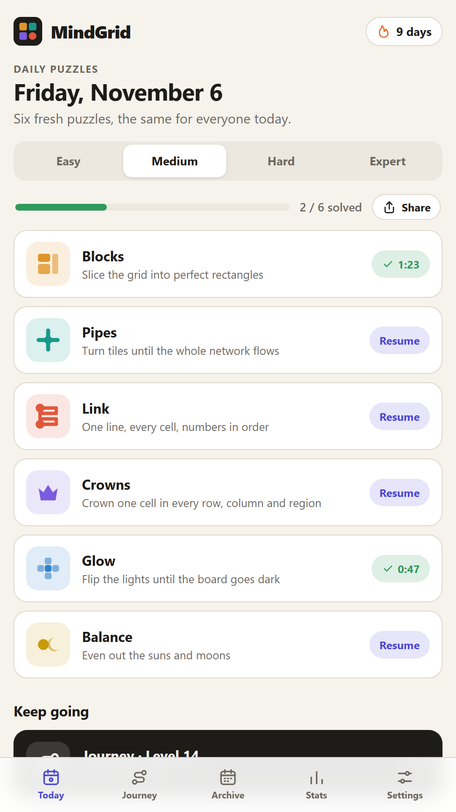
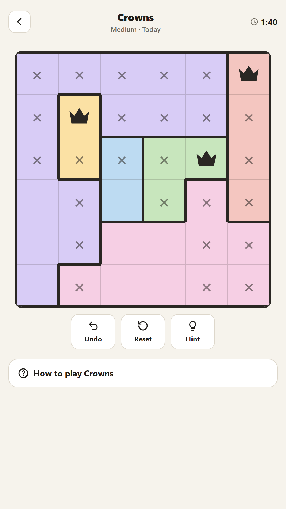
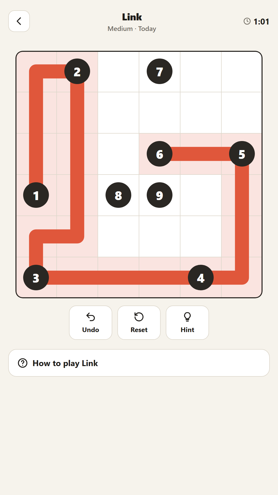
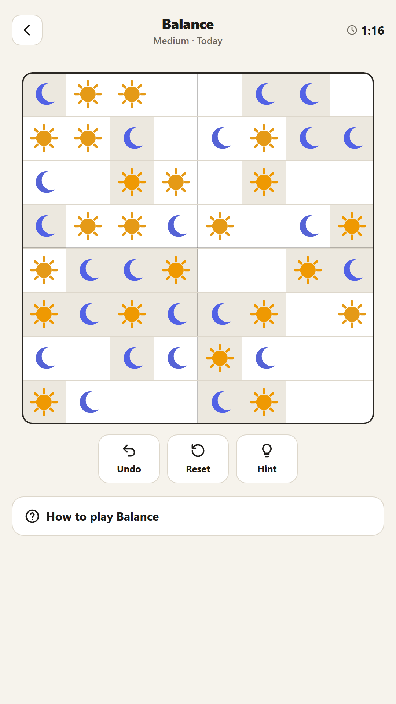

# MindGrid: Daily Logic Puzzles

A calm, minimalist **brain-training game** with six original logic puzzles. There's a new set every day, an endless
level journey, a free archive, streaks and stats. No accounts, and it works offline. The web version is ad-free; the Android app is supported by AdMob ads between levels.

> Built by **MZA Games**. It's in the same genre as daily-puzzle apps such as Voodoo's *The Almanac*. The
> research notes and full design are in [GAME_DESIGN.md](GAME_DESIGN.md). All code, art, puzzle generators and
> names are original.

| | Link |
|---|---|
| ▶ **Play in your browser** | https://mzagames.github.io/mindgrid/ |
| 🤖 **Android beta (Google Play)** | https://play.google.com/apps/testing/com.mzagaming.mindgrid |
| 🛍️ **MZA Gaming store** | https://mzagames.github.io/#mindgrid |
| 🔒 **Privacy policy** | https://mzagames.github.io/mindgrid/privacy.html |
| ✉️ **Support** | mzagames@proton.me |

The Android app (`com.mzagaming.mindgrid`) is in closed testing on Google Play. To join, become a tester through the
link above with the Google account that's on our tester list or in the App Hive group.

<p>
  
  
  
  
</p>

## Puzzles

| | Puzzle | Goal |
|---|---|---|
| 🟧 | **Blocks** | Split the grid into rectangles. Each one holds one number equal to its area. |
| 🟩 | **Pipes** | Rotate tiles so every pipe joins one leak-free network fed by the source. |
| 🟥 | **Link** | Draw one path from 1 through every cell, passing the numbers in order. |
| 🟪 | **Crowns** | One crown per row, column and colour region, and crowns never touch. |
| 🟦 | **Glow** | Tapping flips a plus-shape of lights. Switch them all off. |
| 🟨 | **Balance** | Fill with suns and moons: half of each per row and column, never three alike in a line. |

Every puzzle comes in **Easy / Medium / Hard / Expert**, is generated from a seed (everyone gets the same daily
puzzle), and supports **Undo, Reset, Hint and autosave**. Tap **Share** to copy an emoji summary of your day.

## Pages

| Page | What it does |
|---|---|
| `index.html` | **Home**: Puzzle IQ, Journey button, Daily challenge, Puzzle modes and Mix Mode |
| `daily.html` | **Daily**: the six daily puzzles, difficulty picker, streak, progress, share |
| `play.html` | The puzzle screen: timer, tools, tutorial, win screen |
| `journey.html` | **Journey**: a world map of themed worlds, 12 levels each, with stars |
| `archive.html` | **Archive**: a calendar of every past day (free to replay) |
| `stats.html` | **Puzzle IQ**: rank, skills per puzzle, IQ trend, streaks, best times |
| `settings.html` | Theme (system/light/dark), sound, haptics, timer, reset, install |
| `howto.html` | Rules and controls for all puzzles |

## Run it locally

It's a static site with no build step and no dependencies.

**Windows (no install needed):**
```powershell
powershell -ExecutionPolicy Bypass -File tools/serve.ps1 -Port 8080
```
Then open http://localhost:8080

**Any OS with Node or Python:**
```bash
npx serve .
```
```bash
python -m http.server 8080
```

## Tests

Open `tests/test.html` in the running site (for example http://localhost:8080/tests/test.html). It generates 40 seeds × 4
difficulties × 6 puzzles and checks that every solution passes the win rules (and that Balance puzzles have exactly one solution). With Node installed:

```bash
node tests/generators.test.js 40
```

## Publish on GitHub Pages

1. Push this folder to a GitHub repository.
2. Go to **Settings → Pages → Build and deployment → Source: Deploy from a branch**, then choose `main` and `/ (root)`.
3. After about a minute the game is live at `https://<your-user>.github.io/<repo>/`.

## Project structure

```
index.html play.html journey.html archive.html stats.html settings.html howto.html
manifest.webmanifest  sw.js  assets/icon.svg  .nojekyll
css/style.css
js/core.js                     engine: RNG, storage, theme, sound, icons, nav
js/puzzles/*.js                one file per puzzle: generate() + mount()
js/pages/*.js                  one file per page
tests/                         generator tests (browser + Node)
tools/serve.ps1                tiny local web server for Windows
GAME_DESIGN.md                 full game design document
```
